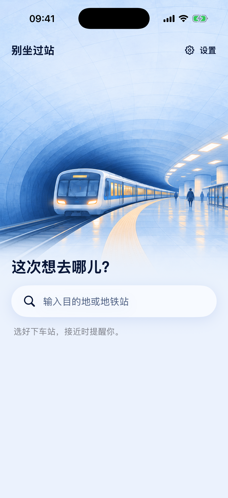
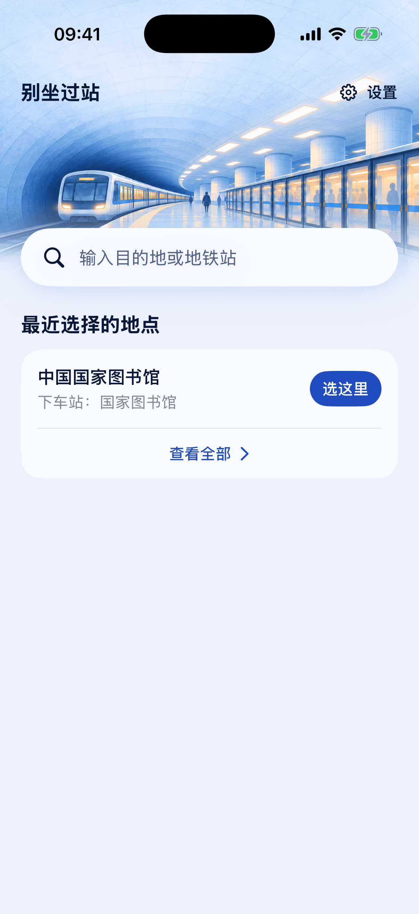
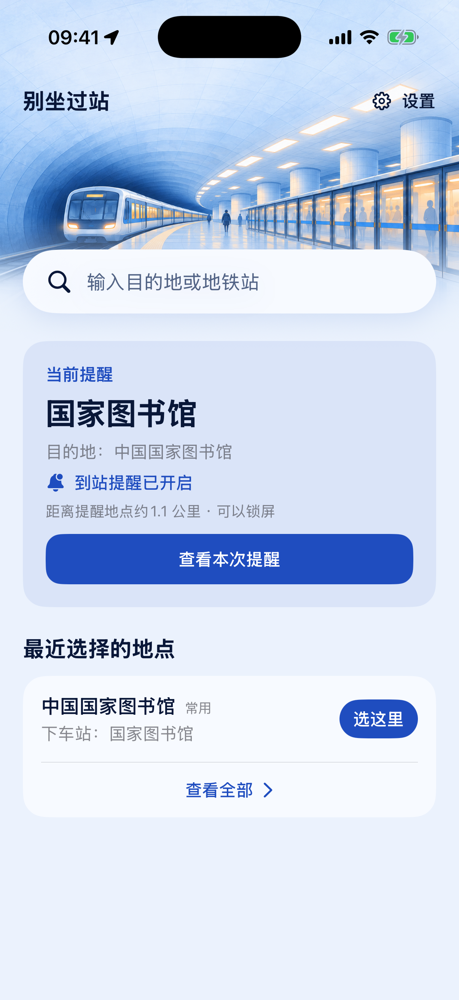
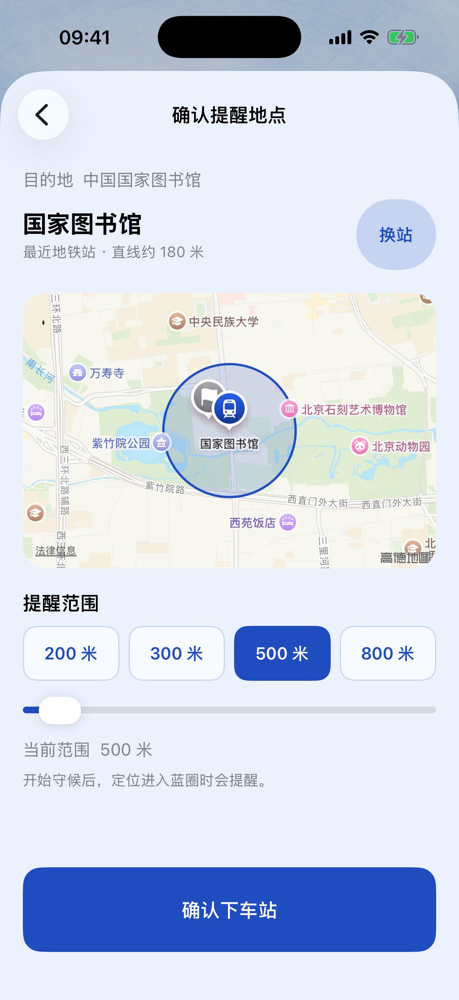
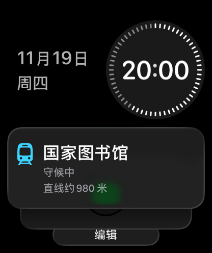

# 别坐过站 · iOS

**坐地铁时，快到下车站了，让 iPhone 提醒你。**

搜你要去的地方，选一个下车站，在地图上圈好提醒范围，再开启提醒。不熟悉当地地铁也能用：App 会推荐目的地附近的站，你也可以自己换站。下车后，还能接着用熟悉的地图 App 步行到目的地。

> **开发中的原型：界面与模拟器流程已跑通，真机签名安装尚未完成。** 下一步先完成手机安装，再做锁屏地铁实测。当前可从源码运行，暂未提供 TestFlight、App Store 下载或可直接安装的安装包。支持 iOS 26 及以上。

## 先看看长什么样

以下均为模拟器截图。保留蓝色地铁风格，首页先搜索，有提醒时优先显示当前状态。图中地点只是操作示例，首次打开没有预设地点，也没有某个城市的固定推荐。

| 第一次打开：先搜目的地 | 选过的地方：下次直接选 | 提醒开启：站名和状态优先 |
| --- | --- | --- |
|  |  |  |

| 地图上选站、看提醒范围 | 确认站点后，开始本次提醒 | 手表上看当前状态 |
| --- | --- | --- |
|  |  |  |

## 怎么用

1. **搜目的地。** 输入地铁站、学校、商场等地点。有历史记录时，也可以直接点「选这里」。
2. **选下车站和范围。** App 按直线距离推荐附近的地铁站，你可以换站。地图上的蓝圈就是提醒范围，圆心是选中的下车站。
3. **开启提醒。** 确认后，点「开始本次提醒」。按提示允许精确位置和通知，看到「到站提醒已开启」后可以锁屏。收到的有效定位进入范围时，App 会提交到站通知；回到详情可以结束提醒。
4. **下车后继续走。** 下车站和最终目的地不同时，可以点「步行到目的地」，选择 Apple 地图，或已安装的高德地图、百度地图。

这里的距离是**直线距离**，不是还剩几站，也不是预计到站时间。地下信号弱时可能收不到及时的位置，锁屏提醒是否可靠还需要真机实测。

## 现在有哪些功能

- **记住选过的地方。** 最近地点保留上次的下车站和范围，常去的地方也会出现在搜索页，减少重复输入。
- **下次到访提醒。** 一趟结束后，可保留同一地点的下次提醒。需要先离开再进入范围，随时可以关闭；是否投递仍受系统定位和通知条件影响。
- **先试一下提醒。** 右上角「设置」→「试一下提醒」，检查位置和通知权限，并发送一条 10 秒后的测试通知。
- **锁屏和手表查看状态。** 提供锁屏实时活动、灵动岛和配对 Apple Watch 的智能叠放卡片；位置过期时会显示提示。手表目前跟随 iPhone 展示，不是独立手表 App。
- **少点几步就能开始。** 选过地点后，长按 App 图标可选「开始上次守候」。也提供同名的控制中心控件和快捷指令动作。
- **从地图带入地点。** 支持地图分享菜单，也支持粘贴地点名、带坐标的地图链接或经纬度。

默认隐藏锁屏上的站名，可在设置中调整。通知权限等影响当前提醒的问题会在任务中提示，设置里也能检查。普通用户不需要查看定位日志。

## 做到哪一步了

截至 **2026-11-20**，当前阶段是“可运行的原型，等待真机安装与实测”。

| 状态 | 当前结果 |
| --- | --- |
| 已实现 | 搜目的地 → 选站和地图范围 → 开始／结束提醒；最近和常用地点；下次到访提醒；地图步行交接；设置与 Debug 定位诊断；锁屏和手表状态展示。 |
| 已验证 | Debug／Release 模拟器构建、未签名真机构建，以及到站判定、常用地点、通知身份与恢复的回归检查通过。模拟器已跑通首页、选站范围、开始／结束、锁屏通知和 Apple 地图步行交接；手表卡片已查看等待定位、守候和位置过期状态。 |
| 尚未完成 | 真机开发签名、手机安装和启动验收。当前没有可直接安装的发布包。 |
| **下一步：安装后做真机实测** | 先完成带定位诊断的 Debug 版安装，再在实际地铁线路锁屏跑一趟，检查会不会漏报、什么时候提醒、声音和振动、手表同步；用定位诊断分清“没收到位置”和“位置被过滤”。另测高德／百度跳转。 |
| 后续再评估 | AlarmKit 静音响铃、独立手表能力。当前没有承诺静音状态下强制响铃。 |

**目前还不能把模拟器表现当成地下线路的提醒保证。** 真机安装与测试方法见 [构建与实测步骤](docs/TESTING.md)。

## 现在能安装体验吗

目前面向愿意从源码运行的开发者，普通用户暂时没有一键安装入口。真机需要 Apple 开发签名、对应设备的安装配置，以及支持该 iPhone 系统版本的 Xcode。生成未签名的 `.app` 文件不代表手机可以安装。

TestFlight 是后续可考虑的试用渠道，尚未发布。iOS 的签名和分发方式见 [Apple 官方说明](https://developer.apple.com/documentation/xcode/distributing-your-app-for-beta-testing-and-releases)。

## 位置与隐私

最近地点、守候设置及按天累计的使用次数保存在本机，可以在设置中清空。地点搜索默认使用 Apple 地图服务，会发送搜索关键词和附近搜索区域；选择外部地图步行时，所选 App 会收到目的地位置。

Debug 版的「设置 → 定位诊断（调试版）」记录回调时间、距离、精度、过滤原因和通知提交结果，**诊断记录不保存经纬度**。“通知已受理”只表示系统接收了请求，是否显示、发声或振动要在手机上核对。正式构建不显示这个诊断入口。

## 从源码运行

在 Mac 上使用带 iOS 26 SDK 的 Xcode 打开 [ArrivalAlarm.xcodeproj](ArrivalAlarm.xcodeproj)，选择 `ArrivalAlarm` scheme 和 iPhone 模拟器，点 **Run**。真机需要使用支持手机系统版本的 Xcode 并配置签名，详见 [构建与实测步骤](docs/TESTING.md)。

## 项目来源

项目源自 [「别坐过站」Android 版](https://github.com/yueqiu666/arrival-alarm-android)。iOS 版使用 SwiftUI、Core Location 和 MapKit，坐标转换的上游署名和许可保留在 [源码](ArrivalAlarm/PlaceCoordinateTransform.swift) 中。
