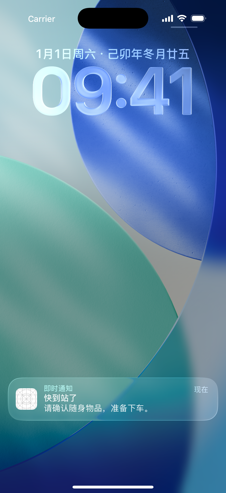
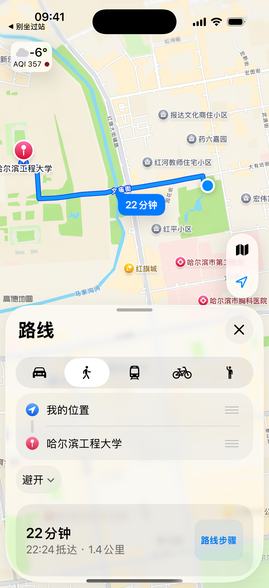

# 别坐过站 · iOS

**坐地铁时，快到下车站了，让 iPhone 提醒你。**

不知道该在哪站下？搜你要去的地方，App 会推荐附近的地铁站。选好站和提醒范围后，就可以开始守候。下车后还能用你习惯的地图 App 走到原来的目的地。

> iOS 26 及以上 · 原型可从源码试用 · [查看验证进度](#当前进度)

**哈尔滨工程大学演示**（iPhone 模拟器）。选站和范围 → 守候中 → 锁屏到站提醒 → 步行到学校。

  
  
  
  

## 怎么用

1. **搜目的地。** 可以输入地铁站名，也可以输入学校、商场等地点。
2. **选下车站和范围。** 按直线距离推荐最近的站，也可以在地图或列表上换站。地图蓝圈就是提醒范围。
3. **开始守候。** 允许精确位置和锁屏通知，看到「守候中」就可以锁屏。有效定位进入蓝圈后，iPhone 会发出到站通知。
4. **下车后继续走。** 如果下车站和目的地是两个地方，在到站详情点「步行到目的地」，可打开 Apple 地图，或选择已安装的高德地图、百度地图。

## 当前功能

- **常去的地点可以复用。** 保存上次选的地点和范围。首页显示「下次还会提醒」时，离开后再次进入同一范围可收到提醒，随时可以关闭。
- **可以先试一下提醒。** 首页右上角打开「检查提醒」，可检查精确位置、锁屏通知，并发送一条 10 秒后的测试提醒。
- **锁屏也能看守候状态。** 接入了 iPhone 锁屏实时活动、灵动岛和配对 Apple Watch 的智能叠放。
- **支持从地图带入地点。** 可从地图 App 的分享菜单发送地点，也可粘贴地点名、带坐标的地图链接或经纬度。

常用同一站时，可打开控制中心，点「＋」→「添加控制」，搜索「别坐过站」并添加「开始上次守候」。以后点这个控件即可打开 App，用上次的地点和范围开始守候。也可在「快捷指令」App 里直接运行同名动作。

## 当前进度

| 阶段 | 结果 |
| --- | --- |
| **源码与构建** | SwiftUI 原型可运行，Debug 和 Release 构建通过。 |
| **模拟器验证** | 跑通了换站、预览范围、锁屏测试通知、锁屏进圈到站提醒，以及用 Apple 地图继续步行。 |
| **待真机验证** | 地下线路的锁屏提醒、通知的声音和振动、Apple Watch 通知，以及高德和百度的实际跳转。静音响铃留待 AlarmKit 实验。 |

模拟器中有过点锁屏通知先回到首页的情况，可从首页「查看到站提醒」继续。当前通过 Xcode 从源码体验。[构建与实测步骤](docs/TESTING.md)

## 位置与隐私

App 在本机保存最近地点和守候设置，锁屏通知默认隐藏站名。地点搜索默认使用 Apple 地图服务。选择用地图 App 步行时，所选 App 会收到目的地位置。Debug 版可查看定位回调时间、距离、精度、过滤原因和通知提交结果，诊断记录不保存经纬度。

## 从源码运行

在 Mac 上使用带 iOS 26 SDK 的 Xcode 打开 [ArrivalAlarm.xcodeproj](ArrivalAlarm.xcodeproj)，选择 `ArrivalAlarm` scheme 和 iPhone 模拟器，点 **Run**。真机签名和测试见 [构建与实测步骤](docs/TESTING.md)。

## 项目来源

项目源自 [「别坐过站」Android 版](https://github.com/yueqiu666/arrival-alarm-android)。iOS 版使用 SwiftUI、Core Location 和 MapKit，坐标转换的上游署名和许可保留在 [源码](ArrivalAlarm/PlaceCoordinateTransform.swift) 中。
